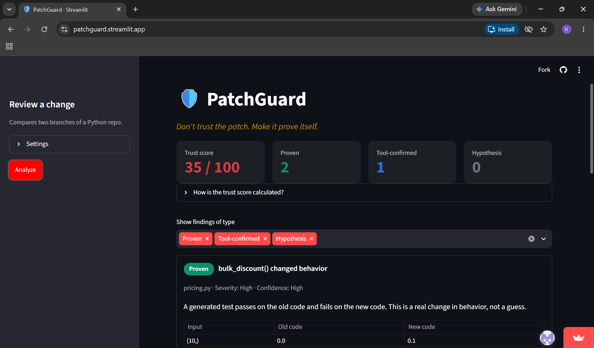

# 🛡️ PatchGuard

**Don't trust the patch. Make it prove itself.**

**Live demo:** https://patchguard.streamlit.app/

(If the page says the app is asleep, press the wake-up button and wait a minute.)

Built for Repo Reboot, I.FEST'26, Problem Statement 04: *Trust, Verify and Review AI-Generated Code.*

## What it does

AI tools can change a lot of code quickly, and reviewing it is the slow part. PatchGuard compares two branches of a Python repo and, instead of just suspecting problems, tries to prove them. Every finding is placed on an **Evidence Ladder** so a reviewer knows how far to trust it.

| Tier | Meaning | How it is earned |
|---|---|---|
| **Proven** | A test generated by the tool fails on the new code and passes on the old code | The tool runs old and new versions of each changed function on edge inputs, writes a small test from the old behavior, and runs it on both versions |
| **Tool-confirmed** | An existing test caught it | A test in the repo passed on the old branch and fails on the new one |
| **Hypothesis** | Behavior differs but nothing proved it wrong | Shown clearly as unverified |

## Features

- Finds which Python functions a change touched (using Python's `ast` module)
- Runs the repo's tests on both versions and reports regressions
- Compares old vs new behavior on edge inputs (0, -1, boundaries, None, empty string)
- Generates a runnable test as evidence for each proven change
- **Verify a fix:** tries a fix in a throwaway copy, re-runs the tests, and reports Passed, Failed or Could not verify with before/after test counts. It comes back as a downloadable patch. Your real branch is never touched.
- Trust score with a visible formula, severity and confidence on each finding
- Dismiss false positives and watch the score update

## Try it

The demo repo is built by `make_sample.py`: a small pricing module where a branch called `ai-change` plants two bugs.
1. A boundary change, `>` became `>=`, that no existing test covers.
2. A discount applied twice, which an existing test catches.

Press **Analyze**, open a Proven finding to see the generated test, then press **Verify a fix**.

## Run it locally

```
git clone YOUR_REPO_URL
cd patchguard
python -m venv .venv
.venv\Scripts\activate        (Mac/Linux: source .venv/bin/activate)
pip install -r requirements.txt
python make_sample.py
streamlit run app.py
```

Command-line version:
```
python -m patchguard.engine sample_repo main ai-change
```

## How the trust score works

Start at 100 and subtract 25 per Proven finding, 15 per Tool-confirmed and 5 per Hypothesis, skipping dismissed ones. It is a simple rule of thumb, not a certified measure of code quality.

## Safety and privacy

- Analysis works on temporary copies of the repo made with `git archive`. Your working branch is never changed.
- Each test run has a time limit.
- Nothing is sent to any external service, and no language model is used in this version.
- The hosted demo only analyzes its built-in sample repo, so visitors can't point it at other paths on the server.
- **Important:** running tests runs the repo's code. The temp copy and time limit are basic precautions, not a full sandbox. Only analyze code you trust. A container-based sandbox is the next step.

## Known limits

- Python projects only
- Edge-case comparison shows what changed, not whether the change is wrong. Only generated tests that fail on new code are called Proven.
- The "fix" is a revert: it puts back the old version of the function. It is verified, but it also undoes the intended change, so a human decides whether to use it.
- Comparison inputs are a fixed list of edge values, so functions that need other types of input may show no differences.
- Duplicate findings (one bug seen as both a failing test and a changed function) are not yet grouped.

## Roadmap

- Smarter fix suggestions, checked by the same verify step
- Optional AI-written hypotheses, always labelled as unverified
- Docker sandbox for running code
- More languages, and a GitHub Action that comments on pull requests
- Remembering dismissed findings

## Project layout

```
app.py                  Streamlit interface
make_sample.py          Builds the demo repo with planted bugs
patchguard/engine.py    Diff analysis, evidence tiers, trust score, fix verification
patchguard/runner.py    Runs one function on edge inputs in a separate process
```